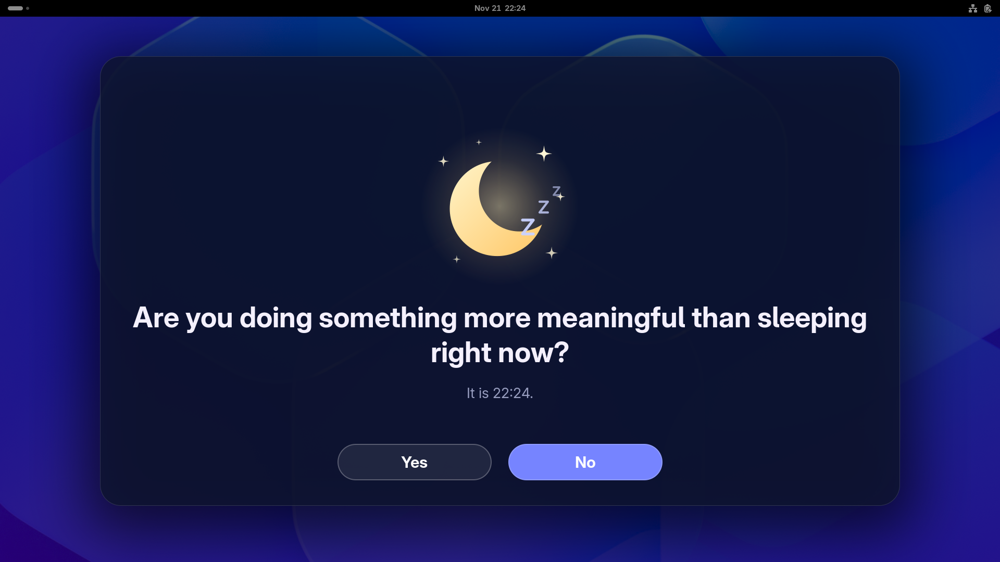
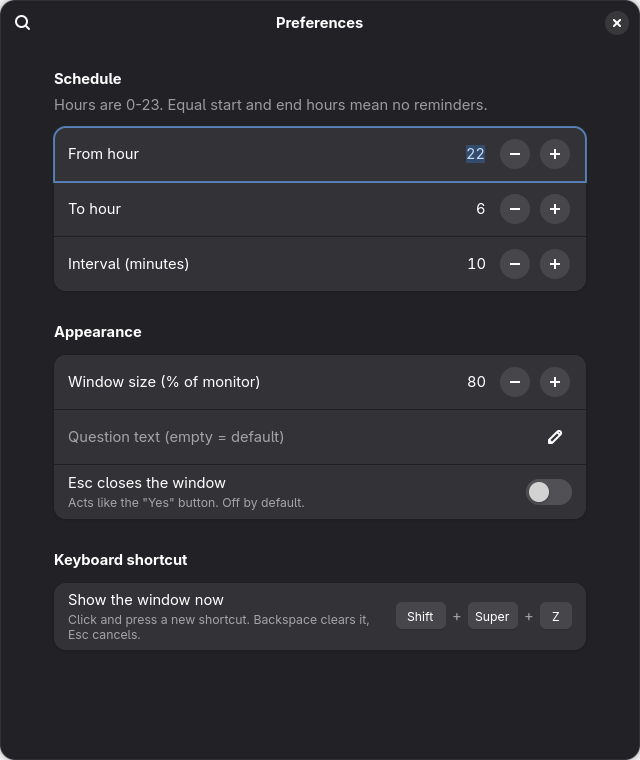

# Go To Sleep

**English** | [Polski](README.pl.md)

A GNOME Shell extension (Wayland). During the night (22:00-6:00 by default) it
shows a semi-transparent window every 10 minutes (80% of the screen, above all
other windows) asking:

> Are you doing something more meaningful than sleeping right now?

- **Yes** - the window goes away and returns after the configured interval
- **No** - the screen is locked (like Super+L) and the window returns after the
  configured interval
- after the end hour the window stays hidden until the next evening

The interface is in English and is shown in Polish when your system language
is Polish.

## Install

    ./install.sh

Copies the extension to `~/.local/share/gnome-shell/extensions/` and adds it to
`enabled-extensions`, so it starts with every login. On Wayland you have to
**log out and back in once** for GNOME to load a newly installed extension.

## Preferences

    gnome-extensions prefs go-to-sleep@niemojewski.eu

(or the "Extensions" app / Extension Manager). You can change: start and end
hour, interval between reminders, window size, question text (empty = the
default, translated text), the keyboard shortcut and whether Esc closes the
window (off by default; acts like "Yes"). Changes apply immediately, no
re-login needed. Equal start and end hours mean no reminders.

## Keyboard shortcut

**Super+Shift+Z** (default) shows the window right away at any time of day. A
window opened this way does not hide itself outside the night hours. It is also
the way to try the extension without waiting for the evening.

## Uninstall

    ./uninstall.sh

## Package for extensions.gnome.org

    ./pack.sh

Builds `dist/<uuid>.shell-extension.zip` and checks that the package contains
nothing the review guidelines forbid (scripts, `.po` files, binaries other than
`.mo`).

## Translations

Strings live in `extension/po/`: the template is `go-to-sleep.pot`, translations
are `<lang>.po`. After changing strings in the code:

    cd extension
    xgettext --from-code=UTF-8 -k_ --language=JavaScript -o po/go-to-sleep.pot extension.js prefs.js
    msgmerge --update po/pl.po po/go-to-sleep.pot

## Limitations

- With several monitors each one gets its own dimming layer and card (80% of
  its size by default); the buttons on any of them work the same.
- While the window is open the shell grabs the keyboard and mouse (modal), so
  other windows do not react until you click Yes/No.
- After logging in during the night the window appears after about ten seconds.
- Changes to the extension code (as opposed to its settings) need a re-login:
  Wayland does not reload code during a session.

## License

GPL-2.0-or-later, see [LICENSE](LICENSE).

Source code and issue tracker: <https://github.com/jazn/go-to-sleep>
