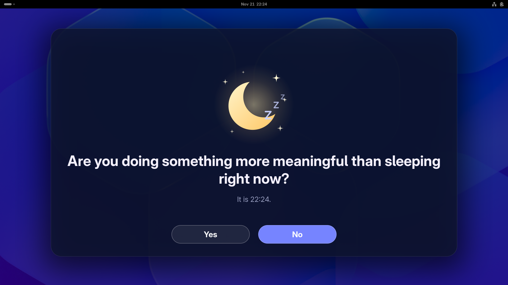
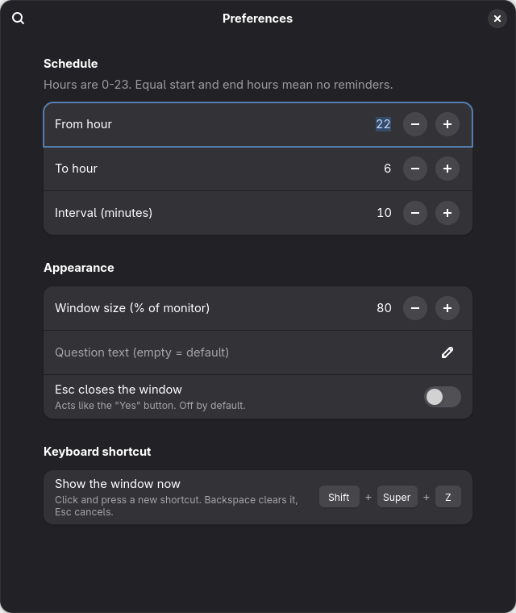

# Go To Sleep

[English](README.md) | **Polski**

Rozszerzenie GNOME Shell (Wayland). W godzinach nocnych (domyślnie 22:00-6:00)
co 10 minut wyskakuje półprzezroczyste okno (80% ekranu, nad wszystkimi oknami)
z pytaniem:

> Czy robisz teraz coś bardziej sensownego niż spanie?

- **Tak** - okno znika, wróci po ustawionym odstępie
- **Nie** - blokada ekranu (jak Win+L), okno wróci po ustawionym odstępie
- po godzinie zakończenia okno znika aż do następnego wieczoru

Interfejs jest po angielsku, a przy polskich ustawieniach języka wyświetla się
po polsku.

## Instalacja

    ./install.sh

Kopiuje rozszerzenie do `~/.local/share/gnome-shell/extensions/` i dopisuje je
do `enabled-extensions`, więc startuje z każdym logowaniem. Na Waylandzie
trzeba się **wylogować i zalogować raz**, żeby GNOME wczytał nowe rozszerzenie.

## Ustawienia

    gnome-extensions prefs go-to-sleep@niemojewski.eu

(albo aplikacja „Rozszerzenia" / Extension Manager). Można zmienić: godzinę
rozpoczęcia i zakończenia, odstęp między przypomnieniami, rozmiar okna, tekst
pytania (puste = tekst domyślny, tłumaczony), skrót klawiszowy oraz to, czy Esc
zamyka okno (domyślnie nie, działa jak „Tak"). Zmiany działają od razu, bez
przelogowania. Równe godziny rozpoczęcia i zakończenia oznaczają brak
przypomnień.

## Skrót klawiszowy

**Super+Shift+Z** (domyślnie) pokazuje okno od razu, o dowolnej porze. Tak
wywołane okno nie znika samo poza godzinami nocnymi. To jest też sposób na
test bez czekania do wieczora.

## Odinstalowanie

    ./uninstall.sh

## Paczka dla extensions.gnome.org

    ./pack.sh

Buduje `dist/<uuid>.shell-extension.zip` i sprawdza, czy w paczce nie ma plików
niedozwolonych przez wytyczne recenzji (skrypty, `.po`, pliki binarne poza `.mo`).

## Tłumaczenia

Teksty są w `extension/po/`. Szablon: `go-to-sleep.pot`, tłumaczenia: `<język>.po`.
Po zmianie tekstów w kodzie:

    cd extension
    xgettext --from-code=UTF-8 -k_ --language=JavaScript -o po/go-to-sleep.pot extension.js prefs.js
    msgmerge --update po/pl.po po/go-to-sleep.pot

## Ograniczenia

- Przy kilku monitorach każdy dostaje własne przyciemnienie i kartę (domyślnie
  80% jego rozmiaru); przyciski na dowolnej z nich działają tak samo.
- Dopóki okno jest otwarte, shell przechwytuje klawiaturę i mysz (modal),
  więc inne okna nie reagują, dopóki nie klikniesz Tak/Nie.
- Po zalogowaniu w godzinach nocnych okno pojawia się po kilkunastu sekundach.
- Zmiany w kodzie rozszerzenia (nie w ustawieniach) wymagają ponownego
  zalogowania: Wayland nie przeładowuje kodu w trakcie sesji.

## Licencja

GPL-2.0-or-later, zobacz [LICENSE](LICENSE).

Kod źródłowy i zgłoszenia błędów: <https://github.com/jazn/go-to-sleep>
